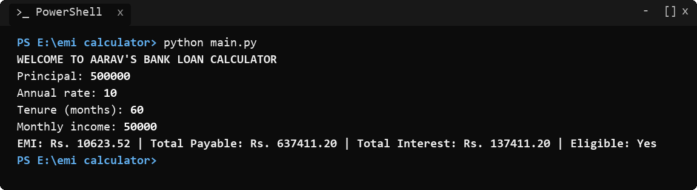
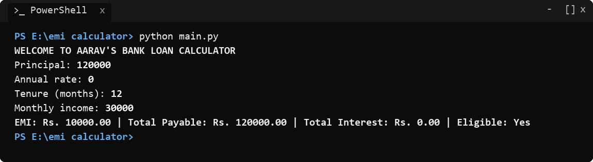
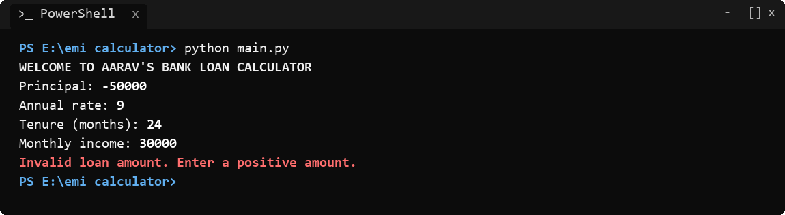
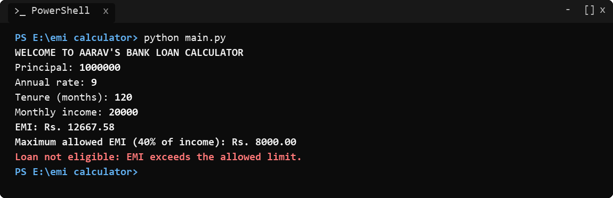

# Bank Loan Calculator (Problem Statement No. 70)

- **Course:** Programming Fundamentals and Logic Building Using Python (`RU-100-01-0021`)
- **Institution:** Rungta International Skills University (RISU)
- **School:** School of Computer Science and Engineering
- **Program:** B.Tech CSE (First Semester)
- **Problem Statement No.:** 70
- **Project Title:** Bank Loan Calculator
- **Language:** Python 3 (Standard Library only)
- **Submission Date:** 16th November 2026

---

## 1. Problem Statement

Write a Python 3 console program that calculates the monthly Equated Monthly Installment (EMI), total payable amount, and total interest for a bank loan, and checks whether the applicant is eligible based on their monthly income. All calculations and logic checks are modularized into dedicated functions.

- **Language:** Python 3 (Standard Library only)
- **Concepts Used:** Functions, Arithmetic & Exponentiation Operators (`**`), Conditional Logic (`if-elif-else`), Boundary Condition Handling (Zero-Interest), Input Validation

---

## 2. Mathematical Model & Financial Rules

### 2.1 Formulae

1. **Monthly Interest Rate ($r$):**
   $$r = \frac{\text{Annual Rate}}{12 \times 100}$$

2. **Monthly EMI Formula:**
   - **Standard Case ($\text{Annual Rate} > 0$):**
     $$\text{EMI} = \frac{P \times r \times (1 + r)^n}{(1 + r)^n - 1}$$
     *Where $P$ is principal loan amount, $r$ is monthly interest rate, and $n$ is tenure in months.*
   - **Zero-Interest Case ($\text{Annual Rate} = 0$):**
     $$\text{EMI} = \frac{P}{n}$$
     *Note: Evaluated conditionally to avoid division-by-zero runtime exceptions.*
   - **Rounding Rule:** The calculated EMI is rounded to 2 decimal places first before total payable calculation.

3. **Total Payable Amount:**
   $$\text{Total Payable} = \text{EMI} \times n$$

4. **Total Interest:**
   $$\text{Total Interest} = \text{Total Payable} - P$$

5. **Eligibility Criterion:**
   - An applicant is eligible if their monthly EMI is less than or equal to 40% of their monthly income:
     $$\text{Max Allowed EMI} = \text{Monthly Income} \times 0.40$$
     $$\text{Eligible} \iff \text{EMI} \le \text{Max Allowed EMI}$$

---

### 2.2 Input Validation Specifications

| Parameter | Valid Range | Error Message on Invalid Input |
|---|---|---|
| **Principal Amount ($P$)** | $P > 0$ | `Invalid loan amount. Enter a positive amount.` |
| **Annual Interest Rate** | $0 \le \text{Rate} \le 30$ | `Invalid interest rate. Enter a rate between 0 and 30.` |
| **Tenure ($n$)** | $1 \le n \le 360$ months | `Invalid tenure. Enter months between 1 and 360.` |
| **Monthly Income** | $\text{Income} > 0$ | `Invalid monthly income. Enter a positive amount.` |

---

## 3. Function Breakdown

| Function | Parameters | Return Type | Description / Responsibility |
|---|---|---|---|
| `calculate_emi(principal, annual_rate, months)` | `principal`, `annual_rate`, `months` | `float` | Computes monthly EMI using formula or zero-interest formula; rounds to 2 decimal places. |
| `calculate_total_payable(emi, months)` | `emi`, `months` | `float` | Computes total amount repaid over loan tenure (`emi * months`), rounded to 2 decimals. |
| `calculate_total_interest(total_payable, principal)` | `total_payable`, `principal` | `float` | Calculates total interest paid (`total_payable - principal`), rounded to 2 decimals. |
| `calculate_max_emi(monthly_income)` | `monthly_income` | `float` | Calculates maximum allowed EMI threshold (40% of monthly income). |
| `is_eligible(emi, monthly_income)` | `emi`, `monthly_income` | `bool` | Returns `True` if `emi <= calculate_max_emi(monthly_income)`, else `False`. |
| `validate_input(principal, annual_rate, months, monthly_income)` | `principal`, `annual_rate`, `months`, `monthly_income` | `str` | Validates parameters against bounds; returns descriptive error string or empty string `""` if valid. |
| `display_result(emi, total_payable, total_interest, monthly_income)` | `emi`, `total_payable`, `total_interest`, `monthly_income` | `None` | Prints the exact formatted output according to eligibility condition. |
| `main()` | `None` | `None` | Welcomes user, prompts for console inputs, coordinates validation, calculations, and display. |

---

## 4. Official Test Cases & Verification

### Test Case 1: Normal Input
- **Input:** Principal: `500000`, Annual rate: `10`, Tenure: `60` months, Monthly income: `50000`
- **Expected Output:**
  ```text
  EMI: Rs. 10623.52 | Total Payable: Rs. 637411.20 | Total Interest: Rs. 137411.20 | Eligible: Yes
  ```


---

### Test Case 2: Boundary / Minimum Input (Zero Interest)
- **Input:** Principal: `120000`, Annual rate: `0`, Tenure: `12` months, Monthly income: `30000`
- **Expected Output:**
  ```text
  EMI: Rs. 10000.00 | Total Payable: Rs. 120000.00 | Total Interest: Rs. 0.00 | Eligible: Yes
  ```


---

### Test Case 3: Invalid Input
- **Input:** Principal: `-50000`, Annual rate: `9`, Tenure: `24` months, Monthly income: `30000`
- **Expected Output:**
  ```text
  Invalid loan amount. Enter a positive amount.
  ```


---

### Test Case 4: Different Valid Scenario (Exceeds EMI Eligibility Limit)
- **Input:** Principal: `1000000`, Annual rate: `9`, Tenure: `120` months, Monthly income: `20000`
- **Expected Output:**
  ```text
  EMI: Rs. 12667.58
  Maximum allowed EMI (40% of income): Rs. 8000.00
  Loan not eligible: EMI exceeds the allowed limit.
  ```


---

## 5. How to Run

1. Open PowerShell or Command Prompt in the project folder:
   ```bash
   cd "E:\emi calculator"
   ```
2. Run the application:
   ```bash
   python main.py
   ```
3. Input the parameters when prompted.

---

## 6. Syllabus Checklist Verification

- [x] Solution written in Python 3 as a single console-run script (`main.py`).
- [x] Separate functions created for EMI calculation, total payable, total interest, and eligibility check.
- [x] Arithmetic and exponent operators (`**`) used correctly.
- [x] Zero-interest case handled cleanly without division by zero.
- [x] Validates amount, rate, tenure, and income with clear error messages.
- [x] Displays results in the exact format shown in the syllabus test cases.
