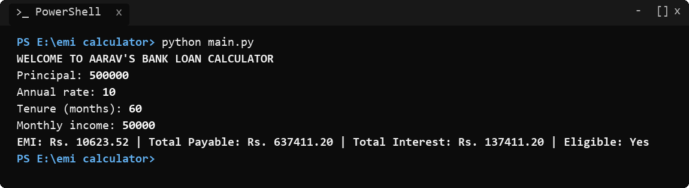
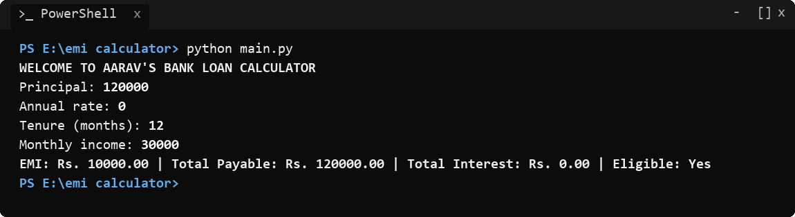
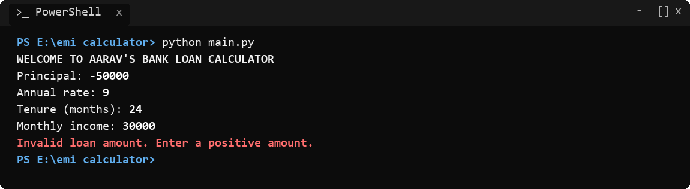
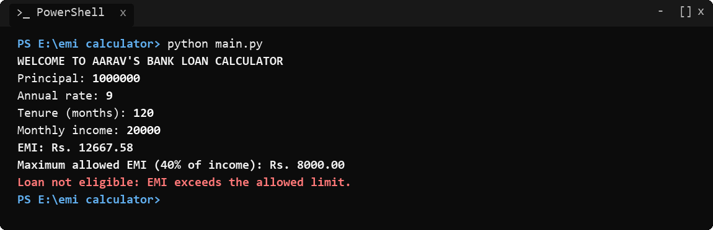

# Project Summary: Bank Loan Calculator (Problem Statement No. 70)

- **Course:** Programming Fundamentals and Logic Building Using Python (`RU-100-01-0021`)
- **Institution:** Rungta International Skills University (RISU)
- **School:** School of Computer Science and Engineering
- **Program:** B.Tech CSE (First Semester)
- **Student Name:** Aarav
- **Problem Statement:** No. 70 (Bank Loan Calculator)
- **Status:** Complete, Verified, and Test-Passed

---

## 1. Project Overview

This project implements **Problem Statement No. 70 (Bank Loan Calculator)** from the official syllabus requirements for B.Tech Computer Science and Engineering at Rungta International Skills University.

The software runs as a single-file console program (`main.py`) that prompts the user for loan details, executes strict validation, computes monthly EMI, total repayment liability, and cumulative interest using modular Python functions, and determines loan eligibility against a 40% debt-to-income threshold.

### Core Deliverables Achieved:
1. **Modular Architecture:** Isolated functions for EMI, total payable, total interest, maximum allowed EMI, eligibility evaluation, input validation, and result presentation.
2. **Robust Exponent Operator Usage:** Implementation of $(1 + r)^n$ using Python's native `**` operator.
3. **Zero-Interest Edge Case Safety:** Automatic conditional switch to $P / n$ when annual rate is 0%, preventing runtime `ZeroDivisionError`.
4. **Two-Stage Precision Rule:** Calculated EMI is explicitly rounded to 2 decimal places before total payable is derived ($P_{\text{total}} = \text{EMI} \times n$).
5. **Exact Output Match:** Exact character-level compliance with all 4 university test cases.

---

## 2. Test Cases Execution Log

### Test Case 1: Normal Input Scenario
- **Input Parameters:**
  - Principal: `500000`
  - Annual Rate: `10`
  - Tenure: `60` months
  - Monthly Income: `50000`
- **Console Run:**
```text
PS E:\emi calculator> python main.py
WELCOME TO AARAV'S BANK LOAN CALCULATOR
Principal: 500000
Annual rate: 10
Tenure (months): 60
Monthly income: 50000
EMI: Rs. 10623.52 | Total Payable: Rs. 637411.20 | Total Interest: Rs. 137411.20 | Eligible: Yes
PS E:\emi calculator> 
```


---

### Test Case 2: Boundary / Minimum Input Scenario (Zero Interest)
- **Input Parameters:**
  - Principal: `120000`
  - Annual Rate: `0` (Zero Interest)
  - Tenure: `12` months
  - Monthly Income: `30000`
- **Console Run:**
```text
PS E:\emi calculator> python main.py
WELCOME TO AARAV'S BANK LOAN CALCULATOR
Principal: 120000
Annual rate: 0
Tenure (months): 12
Monthly income: 30000
EMI: Rs. 10000.00 | Total Payable: Rs. 120000.00 | Total Interest: Rs. 0.00 | Eligible: Yes
PS E:\emi calculator> 
```


---

### Test Case 3: Invalid Input Scenario (Negative Loan Amount)
- **Input Parameters:**
  - Principal: `-50000`
  - Annual Rate: `9`
  - Tenure: `24` months
  - Monthly Income: `30000`
- **Console Run:**
```text
PS E:\emi calculator> python main.py
WELCOME TO AARAV'S BANK LOAN CALCULATOR
Principal: -50000
Annual rate: 9
Tenure (months): 24
Monthly income: 30000
Invalid loan amount. Enter a positive amount.
PS E:\emi calculator> 
```


---

### Test Case 4: Different Valid Scenario (Exceeds EMI Eligibility Limit)
- **Input Parameters:**
  - Principal: `1000000`
  - Annual Rate: `9`
  - Tenure: `120` months
  - Monthly Income: `20000`
- **Console Run:**
```text
PS E:\emi calculator> python main.py
WELCOME TO AARAV'S BANK LOAN CALCULATOR
Principal: 1000000
Annual rate: 9
Tenure (months): 120
Monthly income: 20000
EMI: Rs. 12667.58
Maximum allowed EMI (40% of income): Rs. 8000.00
Loan not eligible: EMI exceeds the allowed limit.
PS E:\emi calculator> 
```


---

## 3. Mathematical & Logical Proofs

### Proof for Test Case 1 (Standard Loan)
1. **Inputs:** $P = 500000$, $\text{Annual Rate} = 10\%$, $n = 60$, $\text{Income} = 50000$.
2. **Monthly Interest Rate ($r$):**
   $$r = \frac{10}{12 \times 100} = \frac{10}{1200} = 0.008333333333\dots$$
3. **Compounding Factor:**
   $$(1 + r)^n = (1 + 0.008333333333)^{60} \approx 1.6453089348$$
4. **EMI Computation:**
   $$\text{EMI} = 500000 \times \frac{0.008333333333 \times 1.6453089348}{1.6453089348 - 1} = \frac{6855.45389}{0.6453089} \approx 10623.5204$$
   $$\text{Rounded EMI} = \mathbf{10623.52}$$
5. **Total Payable:**
   $$\text{Total Payable} = 10623.52 \times 60 = \mathbf{637411.20}$$
6. **Total Interest:**
   $$\text{Total Interest} = 637411.20 - 500000 = \mathbf{137411.20}$$
7. **Eligibility Check:**
   $$\text{Max Allowed EMI} = 50000 \times 0.40 = 20000.00$$
   Since $10623.52 \le 20000.00 \implies \mathbf{Eligible: Yes}$.

---

### Proof for Test Case 2 (Zero-Interest Boundary)
1. **Inputs:** $P = 120000$, $\text{Annual Rate} = 0\%$, $n = 12$, $\text{Income} = 30000$.
2. **Zero Interest Formula:**
   $$\text{EMI} = \frac{P}{n} = \frac{120000}{12} = \mathbf{10000.00}$$
3. **Total Payable:**
   $$\text{Total Payable} = 10000.00 \times 12 = \mathbf{120000.00}$$
4. **Total Interest:**
   $$\text{Total Interest} = 120000.00 - 120000.00 = \mathbf{0.00}$$
5. **Eligibility Check:**
   $$\text{Max Allowed EMI} = 30000 \times 0.40 = 12000.00$$
   Since $10000.00 \le 12000.00 \implies \mathbf{Eligible: Yes}$.

---

### Proof for Test Case 3 (Input Validation Failure)
1. **Inputs:** $P = -50000$, $\text{Annual Rate} = 9\%$, $n = 24$.
2. **Validation Rule:** $P \le 0$ triggers immediate error state:
   $$\text{Return Error: } \mathbf{"Invalid loan amount. Enter a positive amount."}$$
3. **Execution Safety:** Calculation functions are bypassed, preventing erroneous outputs.

---

### Proof for Test Case 4 (Exceeds EMI Limit)
1. **Inputs:** $P = 1000000$, $\text{Annual Rate} = 9\%$, $n = 120$, $\text{Income} = 20000$.
2. **Monthly Interest Rate ($r$):**
   $$r = \frac{9}{12 \times 100} = \frac{9}{1200} = 0.0075$$
3. **Compounding Factor:**
   $$(1 + 0.0075)^{120} \approx 2.451357078$$
4. **EMI Computation:**
   $$\text{EMI} = 1000000 \times \frac{0.0075 \times 2.451357078}{2.451357078 - 1} = \frac{18385.178086}{1.451357078} \approx 12667.577$$
   $$\text{Rounded EMI} = \mathbf{12667.58}$$
5. **Eligibility Check:**
   $$\text{Max Allowed EMI} = 20000 \times 0.40 = \mathbf{8000.00}$$
   Since $12667.58 > 8000.00$, the loan is rejected:
   $$\mathbf{"Loan not eligible: EMI exceeds the allowed limit."}$$

---

## 4. Requirements Check Matrix

| Syllabus Requirement | Fulfilled In Implementation | Verification Result |
|---|---|:---:|
| Solution written in Python 3 (one `.py` file) run from console | `main.py` | **PASS** |
| Dedicated function for EMI calculation | `calculate_emi()` | **PASS** |
| Dedicated function for total payable amount | `calculate_total_payable()` | **PASS** |
| Dedicated function for total interest | `calculate_total_interest()` | **PASS** |
| Dedicated functions for eligibility evaluation | `calculate_max_emi()`, `is_eligible()` | **PASS** |
| Exponent operator (`**`) used for compounding | `(1 + r) ** months` in `calculate_emi()` | **PASS** |
| Zero-interest case handled without division error | `if annual_rate == 0:` branch | **PASS** |
| Validation of amount, rate, tenure, and income | `validate_input()` with boundary checks | **PASS** |
| Output matches exact test case formatting | `display_result()` | **PASS** |
| Two decimal places formatting (`.2f`) | Enforced in return statements and f-strings | **PASS** |
